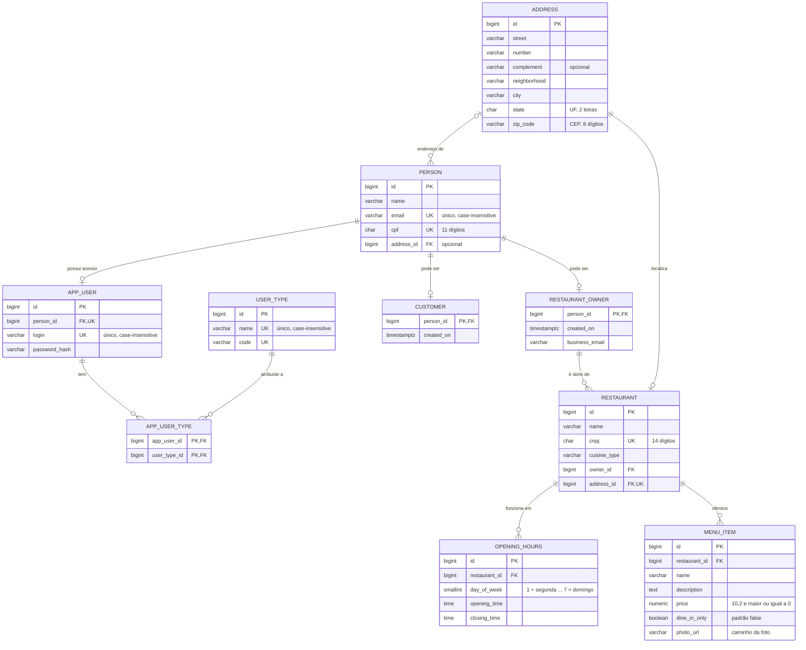

# Restaurante Fase 2


## Executando com Docker

A aplicação sobe em dois contêineres, definidos em `docker/docker-compose.yml`:

| Serviço | Contêiner | Porta | O que é |
| --- | --- | --- | --- |
| `db` | `db-postgres` | 5432 | PostgreSQL 18 |
| `backend` | `backend-restaurante` | 8080 | A API (Spring Boot), rodando com o perfil `docker` |

### Pré-requisitos

- As portas 8080 e 5432 livres.

Não é preciso ter Java nem Maven instalados: o projeto é compilado dentro da imagem.

### 1. Configurar as variáveis

O Compose lê as variáveis do arquivo `docker/.env`. Se ele não existir, crie-o a partir do exemplo:

```bash
cp docker/.env.example docker/.env
```

| Variável | Para que serve |
| --- | --- |
| `DB_USER`, `DB_PWD`, `DB_NAME` | Usuário, senha e nome do banco criados no PostgreSQL |
| `POSTGRES_ALPINE_GROUP_UID`, `POSTGRES_ALPINE_USER_UID` | Usuário (não root) com que o contêiner do banco roda. `70` é o usuário `postgres` da imagem Alpine |
| `POSTGRES_DEBIAN_GROUP_UID`, `POSTGRES_DEBIAN_USER_UID` | Só são usadas se a imagem do banco for trocada pela versão Debian |

> **Atenção:** a API não lê essas variáveis. Ela se conecta com o usuário `admin`, a senha `123456` e o banco `restaurante`, definidos em `src/main/resources/application.properties`. Se mudar `DB_USER`, `DB_PWD` ou `DB_NAME` no `.env`, ajuste também as propriedades `spring.datasource.*`, senão a API não consegue se conectar ao banco.

### 2. Subir a aplicação

A partir da pasta `docker`:

```bash
cd docker
docker compose up -d --build
```

- O `--build` compila o projeto dentro da imagem com `mvnw clean package -DskipTests` (os testes não rodam nesse build). A primeira execução é mais lenta porque baixa as dependências do Maven; as seguintes reaproveitam o cache.
- O `backend` só é iniciado depois que o banco passa no healthcheck, o que leva cerca de um minuto na primeira subida.
- Ao iniciar, o Flyway cria as tabelas (scripts em `src/main/resources/db/migration`), cadastra os tipos de usuário iniciais (`restaurant_owner`, `customer`, `staff`, `premium_customer` e `admin`) e cria três usuários para acessar a API (ver abaixo).

### 3. Acessar

- Swagger: <http://localhost:8080/my-docs>
- OpenAPI em JSON: <http://localhost:8080/api-docs>
- Endpoints: `http://localhost:8080/api/...` (ver [Endpoints](#endpoints))

### Banco de dados

O PostgreSQL também fica acessível pela sua máquina em `localhost:5432` (banco `restaurante`, com o usuário e a senha do `.env`), para consultar os dados com DBeaver, pgAdmin ou `psql`. Os dados ficam no volume `postgres_data` e são mantidos entre reinícios.

### Parar, atualizar e limpar

```bash
docker compose down           # para e remove os contêineres; os dados do banco são mantidos
docker compose up -d --build  # depois de alterar o código: recompila a imagem e sobe de novo
docker compose down -v        # para e apaga também o volume do banco (todos os dados são perdidos)
```

## Arquitetura

O projeto segue a **Clean Architecture** com um pacote `core` com as regras de negócio, sem nenhuma dependência de framework, e um pacote `infra` com tudo que depende de Spring, JPA ou HTTP.

```
br.com.fiap.restaurante
├── core                         # Java puro (sem Spring, JPA ou Jakarta Validation)
│   ├── controller               # Controllers do core: recebem DTOs e chamam os use cases
│   ├── domain                   # Entidades de domínio com suas validações + implementações das factories
│   ├── dto                      # DTOs de entrada/saída dos use cases
│   ├── exception                # Exceções de negócio (código + status HTTP sugerido)
│   ├── factory                  # Interfaces das factories (criação e reconstrução das entidades)
│   ├── gateway                  # Interfaces de saída (persistência), implementadas pela infra
│   └── usecase                  # Casos de uso: interfaces (implementações em usecase/impl)
└── infra                        # Detalhes de framework
    ├── config                   # Injeção de dependência (@Bean), segurança e documentação (Swagger)
    ├── database
    │   ├── jpa                  # Gateways JPA (implementam core.gateway)
    │   │   ├── converter        # Conversores JPA
    │   │   ├── entity           # Entidades @Entity (modelo de persistência)
    │   │   └── repository       # Spring Data
    │   └── mapper               # Conversão entidade JPA <-> domínio
    ├── security                 # Autenticação pelos usuários da aplicação e hash de senha (BCrypt)
    └── web                      # @RestController (APIs), tratamento de erros HTTP
        └── json                 # Corpo das requisições com Bean Validation
```

### Fluxo de uma requisição

`UserTypeApi` (infra/web) valida o JSON → `UserTypeController` (core) → `CreateUserTypeUseCase` (core) → `UserTypeFactory` cria a entidade de domínio, que valida suas regras → `UserTypeGateway` (interface do core) → `UserTypeJpaGateway` (infra) usa o `UserTypeMapper` e o `UserTypeRepository` para persistir.

### Regras que mantêm a arquitetura

- **A dependência aponta para dentro:** `infra` conhece `core`; `core` não conhece `infra`.
- **O domínio não é a entidade JPA.** `core.domain.UserType` e `infra.database.jpa.entity.UserTypeEntity` são classes diferentes; o mapper faz a conversão.
- **Os use cases e controllers do core não têm anotações do Spring.** Eles viram beans apenas em `infra/config/DependencyInjectionConfiguration`.
- **Erros de negócio** são exceções do core (`SystemBaseException`) com código e status; o `GlobalExceptionHandler` da infra só as traduz para HTTP.
- O `ArchitectureTest` (ArchUnit) falha o build se alguma classe do `core` passar a depender da `infra` ou de qualquer biblioteca fora do JDK.

## Endpoints

Todas as rotas exigem autenticação HTTP Basic com o login e a senha de um usuário cadastrado (ver `SecurityConfig` e `AppUserDetailsService`; usuários iniciais em [Executando com Docker](#3-acessar)). Erros de negócio retornam `{"error", "code", "message"}` com o status indicado pela exceção do core.

A documentação interativa (Swagger, em português) fica em `/my-docs`, e o JSON do OpenAPI em `/api-docs`. Essas duas rotas não exigem autenticação; para testar os endpoints pelo Swagger, informe usuário e senha no botão *Authorize*.

| Recurso | Rotas |
| --- | --- |
| Tipos de usuário | `POST/GET /api/user-types`, `GET/PUT/DELETE /api/user-types/{id}` |
| Usuários | `POST/GET /api/app-users`, `GET/DELETE /api/app-users/{id}`, `PATCH /api/app-users/{id}/password` |
| Tipos de um usuário | `GET /api/app-users/{appUserId}/types`, `POST/DELETE /api/app-users/{appUserId}/types/{userTypeId}` |
| Pessoas | `POST/GET /api/persons`, `GET/PUT/DELETE /api/persons/{id}` |
| Clientes | `POST/GET /api/customers`, `GET/PUT/DELETE /api/customers/{id}` |
| Donos de restaurante | `POST/GET /api/restaurant-owners`, `GET/PUT/DELETE /api/restaurant-owners/{id}` |
| Restaurantes | `POST/GET /api/restaurants`, `GET/PUT/DELETE /api/restaurants/{id}` |
| Itens do cardápio | `POST/GET /api/menu-items`, `GET/PUT/DELETE /api/menu-items/{id}`, `GET /api/menu-items/restaurant/{restaurantId}` |

Exemplo de cadastro de restaurante:

```json
{
  "name": "Cantina da Maria",
  "cnpj": "12.345.678/0001-99",
  "cuisineType": "Italiana",
  "ownerId": 1,
  "address": { "street": "Av. Paulista", "number": "1000", "neighborhood": "Bela Vista",
               "city": "São Paulo", "state": "SP", "zipCode": "01310-100" },
  "openingHours": [
    { "dayOfWeek": "MONDAY", "openingTime": "11:00", "closingTime": "15:00" },
    { "dayOfWeek": "FRIDAY", "openingTime": "18:00", "closingTime": "02:00" }
  ]
}
```

### Principais regras de negócio

- **Pessoa:** pode ser cadastrada sem papel (um administrador, por exemplo) e, depois, passar a ser cliente e/ou dona de restaurante. CPF (11 dígitos) e e-mail são únicos; CPF, CNPJ e CEP aceitam pontuação e são gravados só com dígitos. O endereço é opcional e, se omitido na atualização, é removido.
- **Usuário:** uma pessoa tem no máximo um usuário; o login é único (minúsculo, letras/números/`._-`). A senha precisa de 8 a 72 caracteres, com letras e números, e só o hash BCrypt é gravado.
- **Cliente e dono de restaurante** são cadastrados com os dados da pessoa, e o ID de cada um é o da pessoa. Se o CPF já existir (pessoa sem papel ou com o outro papel), ela é reaproveitada e os dados enviados substituem os gravados. Remover um papel não exclui a pessoa, mesmo que seja o último; para isso, use `DELETE /api/persons/{id}`, que exclui junto o endereço, os papéis e o usuário de acesso.
- **Restaurante:** o dono precisa estar cadastrado como dono de restaurante, o CNPJ é único e é obrigatório ao menos um horário. Os turnos não podem se sobrepor, e um fechamento menor que a abertura indica que o turno termina no dia seguinte.
- Não é possível remover o papel de dono, nem excluir a pessoa, enquanto ela tiver restaurantes; só é possível cadastrar item de cardápio em restaurante existente.

## Collection do Postman

A collection [`postman/restaurante-fase2.postman_collection.json`](postman/restaurante-fase2.postman_collection.json) testa todos os endpoints da API, com asserções sobre o status e o corpo de cada resposta.

### Como executar

Com a aplicação no ar (ver [Executando com Docker](#executando-com-docker)):

- **Postman:** importe o arquivo (*Import*) e execute a collection pelo *Collection Runner* (*Run*). Também é possível executar uma única pasta de cenário.

Dentro de cada pasta, as requisições devem ser executadas na ordem em que aparecem, pois são cenários autocontidos, independentes do conjunto de requisições fora daquela pasta.

Cada recurso tem uma subpasta **CRUD**, com os fluxos de sucesso, e uma subpasta **Validações**, com campos obrigatórios, formatos inválidos (CPF, CNPJ, CEP, UF, e-mail), duplicidades, regras de negócio e registros inexistentes.

### Cenários autocontidos

Cada pasta de cenário cria, nos primeiros passos, os dados de que precisa (pessoa, dono, restaurante etc.) e guarda os IDs em variáveis da collection para os passos seguintes. Nenhum cenário depende de dados criados por outro.

Antes de cada requisição, um script da collection gera CPF, CNPJ, e-mail, login e código de tipo de usuário únicos. Assim, a collection pode ser executada várias vezes sobre o mesmo banco sem conflito.

### Variáveis

| Variável | Padrão | Uso |
| --- | --- | --- |
| `host` | `localhost` | Host da API |
| `port` | `8080` | Porta da API |
| `authLogin` / `authPassword` | `admin` / `admin12345` | Usuário HTTP Basic enviado em todas as requisições (criado pela migration `V3__create_initial_users.sql`) |

As demais variáveis são preenchidas pelos próprios testes durante a execução.

> **Atenção:** a execução grava dados de teste no banco (pessoas, restaurantes, pratos etc.). Para descartá-los, use `docker compose down -v`, que apaga o volume do banco com todos os dados.

## Diagrama Entidade-Relacionamento


